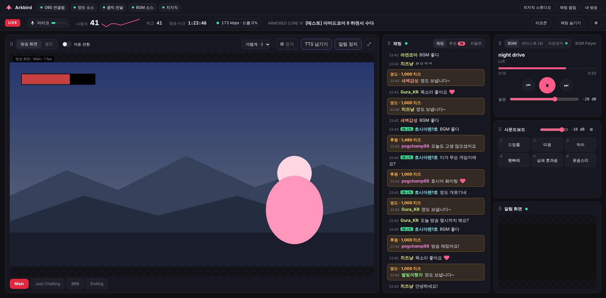

# Allmind

"스트리머 통합 지원 시스템, 올마인드 입니다."

2PC 방송을 위한 통합 대시보드예요. **방송 PC**에서 `Allmind.exe` 하나만 켜 두면, 메인 PC·아이패드·폰에서는 브라우저로 주소만 열어서 써요. OBS와 치지직을 이어서 방송 중에 필요한 것을 한 화면에 모았어요.


<sub>OBS·치지직 목업 데이터로 만든 시뮬레이션 화면이에요.</sub>

**[⬇ 최신 버전 받기](../../releases/latest)** — `Allmind-x.y.z.exe` 파일 하나 (Windows 10/11, 설치 필요 없음). 처음 한 번만 받으면 그다음부터는 앱 안에서 업데이트해요 (아래 **🔄 업데이트**).

> 처음 실행할 때 *"Windows의 PC 보호"* 창이 뜨면 **추가 정보 → 실행**을 누르세요. 코드 서명이 없는 프로그램이라 그래요.

---

## 한눈에

| | 하는 일 |
|---|---|
| 🎬 **방송 화면 · 영도** | OBS 화면을 그대로 보고, 영도를 클릭·스크롤·광고 스킵까지 대시보드에서 조작 |
| 🎵 **BGM · 사운드보드** | 음악 폴더를 셋리스트로 재생, 영도가 나오면 자동으로 멈춤 · 효과음 버튼 |
| 💬 **채팅 · 후원** | 치지직 채팅·후원·구독, 시청자 정보, 대시보드에서 채팅 보내기 |
| 📝 **방송 준비** | 치지직 제목·카테고리·태그, 유튜브 제목, 녹화 파일 이름을 한 번에 |
| ✅ **점검 · 📋 방송 기록** | 방송 전 점검(OBS·녹화·유튜브·로그인 등을 한 번에), 방송이 끝나면 리포트 |
| ⭐ **마크 · 채팅 로그** | 웃긴 순간 표시 + 녹화 시간에 맞춘 채팅 기록 (유튜브 편집용) |
| ▶️ **유튜브 · 드라이브** | 비공개 유튜브 아카이브 지키기, 녹화를 드라이브에 자동 업로드 |
| 🎮 **Xylem (시청자 참여)** | 치즈 룰렛, 공중전 미니게임, VTube Studio 던지기 — 방송 중에도 업데이트 |
| 🎚️ **스트림덱** | BGM·사운드보드 키, 지금 재생 중인 곡이 키에 표시 |
| 📱 **어디서나** | 메인 PC·아이패드·폰 화면 지원, 패널 배치 자유롭게 |

---

## 시작하기 (방송 PC, 처음 한 번)

1. 받은 exe를 아무 폴더에 두고 실행해요. 방화벽 창이 뜨면 **개인 네트워크**를 허용하세요.
2. **설정 창**이 열려요. **기본** 칸들(**OBS 연결 → 치지직 채널 → BGM · 사운드보드 → 화면 소스 → 다른 기기에서 열기**)을 위에서부터 차례로 채우면 돼요. 칸마다 왜 필요한지와 단계별 안내가 있고, 끝난 단계에는 ✓가 붙어요.
3. OBS를 닫은 상태에서 **OBS 시작**을 눌러요. 영도 클릭 전달·광고 스킵은 Allmind가 켠 OBS에서만 돼요.
4. 대시보드 BGM 칸에서 **현재 장면에 만들기** → OBS에서 `BGM Player`를 BGM 오디오 트랙에 지정하고 모든 장면에 추가(**+ → 미디어 소스 → 기존 항목 추가**). 사운드보드도 같은 방식이에요.
5. 필요한 **연동**(유튜브·드라이브·치지직 연동·리모컨·스트림덱)은 쓰고 싶은 것만 하면 돼요.

**메인 PC · 아이패드 · 폰에서 열기**: 설정 창의 **다른 기기에서 열기**에 나온 주소(예: `http://192.168.0.10:8080`)를 열어요. 메인 PC 크롬은 **⋮ → 저장 및 공유 → 바로가기 만들기 → 창으로 열기**, 아이패드·폰은 **홈 화면에 추가**하면 앱처럼 써요.

> 다른 PC에서 쓰던 설정이 있다면 아래 **📦 설정 옮기기**로 가져오세요. 작업표시줄에 고정하려면 Allmind 창을 연 채로 작업표시줄 아이콘 오른쪽 클릭 → **작업 표시줄에 고정**.

---

## 기능 안내

<details>
<summary><b>🎬 방송 화면 · 영도</b></summary>

- **방송 화면 / 영도 탭**: OBS가 그리는 화면을 그대로 보여 줘요. 영도가 재생되면 자동으로 영도 탭으로 넘어가요(**자동 전환** 스위치로 끌 수 있어요).
- **영도 조작**: 클릭·마우스 이동·스크롤이 OBS 안의 영도 페이지로 전달되고, **광고 스킵**(수동/자동)도 돼요. 멈췄으면 **↻**로 새로고침, **⤢**로 전체 화면.
- **화질**: 가볍게(30fps) · 부드럽게 · 균형 · 고화질(최대 60fps) · 무손실(PNG).
- **알림 화면**: 도네 알림 소스를 방송에 나가는 모습 그대로 확인.
- **OBS 부하 보호**: OBS가 프레임을 놓치기 시작하면 미러링을 자동으로 줄여서 방송에 영향을 주지 않아요.
- **방송 상태**: LIVE/OFFLINE, 시청자 수와 추이, 방송 시간, 비트레이트·드롭 프레임·지연.
- **스튜디오 조작**: 장면 전환, 마이크 음소거와 레벨 미터, ■ 정지 / 넘기기 / 알림 정지 (치지직 리모컨 — 설정 창 **연동 → 치지직 리모컨**에서 OBS 독 하나만 추가).

</details>

<details>
<summary><b>🎵 BGM · 사운드보드 · 영도 자동 일시정지</b></summary>

- **BGM 셋리스트**: 음악 폴더를 OBS 미디어 소스 하나로 재생. 순서·셔플·한 곡 반복, 순서 바꾸기, 검색, 재생 위치·볼륨. 곡을 추가하면 **↻**. 앨범 커버는 자동으로 빼고 재생해요(원본은 그대로) — OBS 오디오 지연이 쌓이지 않아요.
- **사운드보드**: 효과음 폴더의 파일마다 버튼. 누르면 재생, 다시 누르면 정지. 파일을 넣으면 자동으로 추가돼요.
- **영도 자동 일시정지**: 영도 소리가 나면 BGM을 멈추거나(또는 볼륨을 낮추고) 끝나면 되돌려요. 첫 알림부터 영상 끝까지 끊기지 않게 유지돼요. 음악 칸의 **자동정지** 탭에서 설정.
- ⚠ BGM·사운드보드 소스는 OBS에서 **숨기지 마세요** — 숨긴 소스는 소리가 꺼져요. 안 보이게 하려면 그룹 크기를 0으로.

</details>

<details>
<summary><b>💬 채팅 · 후원 · 시청자 정보</b></summary>

- **채팅**: 치지직 채팅(이모티콘, 후원·영도·구독 강조).
- **채팅 보내기**: 채팅 칸 아래 입력창에 쓰고 Enter — 내 계정으로 올라가요 (100자까지). 설정 창 **연동 → 치지직 연동**이 필요하고, CHZZK Developers 앱 권한에 **채팅 메시지 쓰기**가 있어야 해요.
- **후원 탭**: 이번 방송의 후원·영도·미션·구독 목록, 읽음 표시와 **모두 읽음** (다시 켜도 유지).
- **위플챗 탭**: 위플챗 OBS 소스를 그대로. 비어 있으면 **⇄**로 보기 방식 바꾸기.
- **시청자 정보**: 닉네임을 누르면 채팅 수, 최근 채팅, 후원·구독 기록과 치지직 채널 링크.

</details>

<details>
<summary><b>📝 방송 준비</b></summary>

대시보드 위쪽 **방송 준비** 버튼 (폰에서도 돼요). 설정 창 **연동 → 치지직 연동**이 필요해요.

- 치지직 **제목·카테고리(검색)·태그**를 적고 **적용** → 치지직 · 유튜브 · 녹화 파일 이름에 한 번에 들어가고, 각각 성공했는지 보여 줘요.
- 유튜브 제목과 녹화 파일 이름은 치지직 제목을 따라가요(`날짜 - 제목`). 직접 고치면 그대로 쓰이고, **↺ 자동**으로 되돌려요.
- 드라이브 업로드 목록에서 올리기 전 파일 이름을 고칠 수 있어요.

</details>

<details>
<summary><b>✅ 방송 전 점검 · 📋 방송 기록</b></summary>

**점검** (대시보드 위쪽): 방송 전에 문제가 될 만한 것을 한 번에 확인해요. 문제가 있으면 버튼에 숫자가 떠요 (OBS가 연결될 때와, 대시보드가 열려 있으면 10분마다 저절로 점검).

- OBS: 연결, 클릭 전달(Allmind가 켠 OBS인지), **OBS 켜진 시간**(20시간 넘으면 다시 켜라고 알려 줘요), 녹화 형식(Hybrid MP4), 녹화 오디오 트랙 수, 녹화 디스크 남은 공간
- 화면·소리: BGM·사운드보드 소스(숨겨져 있지 않은지), 영도·위플챗 소스, 마이크 음소거
- 치지직 채널, 치지직 연동 로그인(곧 만료되는지), 리모컨 독
- 유튜브 아카이브(로그인·스트림 키·비공개 방송 준비), 드라이브 업로드(로그인·실패한 업로드), VTube Studio, Allmind 업데이트
- 항목마다 **어디서 고치는지**가 같이 나와요.

**방송 기록**: OBS 방송이 끝나면 리포트가 저절로 만들어져요 (위쪽 버튼에 점이 떠요). 방송 시간, 최고 시청자, 채팅 수·참여한 사람·처음 온 사람, 후원·영도·구독, ⭐ 마크, 룰렛(아직 안 한 결과), 방송 품질(드롭·렌더·인코딩), 유튜브 아카이브가 올라갔는지, 녹화 업로드 상태, 방송 중 생긴 문제. 최근 30개를 보관해요.

**채팅 화면 지우기**: 채팅 칸의 🧹 — 모든 기기의 채팅 화면이 비워져요 (후원 목록·시청자 정보는 그대로). 방송이 시작되면 채팅에 **— 방송 시작 —** 줄이 저절로 들어가서 지난 방송 채팅과 구분돼요.

</details>

<details>
<summary><b>⭐ 마크 · 💬 채팅 로그 (유튜브 편집용)</b></summary>

OBS가 **녹화 중**이면 상단에 노란 **★ 마크** 버튼이 생겨요. 웃긴 순간에 누르기만 하면 돼요.

- **누르는 곳**: 대시보드 버튼 · 폰/아이패드의 `http://<방송 PC 주소>:8080/mark` (큰 버튼 하나짜리 페이지) · 스트림덱 웹사이트 동작 `/deck/mark` · 단축키를 켰다면 `M`.
- **메모**: **▾** 목록에서 마크마다 메모 (녹화가 끝난 뒤에도).
- **저장**: 녹화가 끝나면 영상 옆에 `<영상 이름>.markers.json`. 녹화 중 채팅·후원도 영상 시간에 맞춰 같이 저장돼요(닉네임·역할·내용만). 설정 창 **치지직 채널** 칸에서 채팅 저장을 끌 수 있어요.
- **올리기**: 드라이브 자동 업로드가 켜져 있으면 영상과 함께 올라가요. 직접 올릴 때는 영상과 같은 폴더에.
- **추천 OBS 설정**: *출력 → 녹화 형식: Hybrid MP4* (OBS 30.2+) — 마크가 영상 안에 챕터로도 들어가요. 바꾼 뒤 오디오 트랙 5개가 따로 들어가는지 테스트 녹화로 확인하세요.

<details>
<summary>메인 PC 단축키로 마크 (AutoHotkey 예시)</summary>

`POST http://<방송 PC 주소>:8080/api/mark` (메모: `{"label":"메모"}`)

```ahk
^!m:: {
  req := ComObject("WinHttp.WinHttpRequest.5.1")
  req.Open("POST", "http://192.168.0.10:8080/api/mark", false)
  req.Send()
}
```
</details>

</details>

<details>
<summary><b>▶️ 유튜브 아카이브 · ☁️ 드라이브 자동 업로드</b></summary>

설정 창 **연동**의 **Google 계정 → 유튜브 아카이브 → 드라이브 자동 업로드** 칸에 단계별 안내가 있어요.

**Google 계정** (둘 다 필요)
- 내 Google Cloud 프로젝트를 만들어 클라이언트 ID·보안 비밀번호를 넣고 로그인. 프로젝트는 꼭 **게시(프로덕션)** 상태로 — 테스트 상태면 7일마다 로그인이 풀려요. (게시에는 Branding의 홈페이지·개인정보처리방침 주소가 필요해요. 내 채널 주소 같은 공개 페이지면 돼요.)
- 허용 화면이 **두 번** 나와요: ① 유튜브 — **아카이브 채널** (브랜드 채널 가능) ② 드라이브 — **녹화를 올릴 폴더가 있는 계정**.

**유튜브 아카이브 지키기**
- Allmind가 **전용 스트림 키**를 만들어요. 나온 주소·키를 OBS Multi-RTMP의 유튜브 대상에 한 번만 넣으면 돼요.
- 방송마다 **비공개 · 자동 시작 · 자동 종료** 방송을 미리 준비 — 지난 방송 결과 화면 때문에 유튜브가 안 켜지는 일이 없어요.
- 방송 중 1분마다 확인: 공개로 바뀌면 바로 비공개로 되돌리고, 유튜브가 시작되지 않으면 대시보드(폰 포함)에 빨간 알림.

**드라이브 자동 업로드**
- 녹화가 끝나면 영상과 `.markers.json`을 **올릴 폴더**(드라이브 폴더 링크)에, 비워 두면 "Allmind 녹화" 폴더에.
- 이름은 `2026-10-26 - 방송 제목.mp4` (그 녹화에서 가장 오래 걸린 치지직 제목). 원본은 그대로예요.
- **방송·녹화 중에는 올리지 않아요.** 끊겨도 다시 켜도 이어서 올리고, 속도 제한도 걸 수 있어요.

</details>

<details>
<summary><b>🎮 Xylem — 치즈 룰렛 · 공중전 · VTube Studio</b></summary>

대시보드의 **🎮 Xylem** 버튼(또는 트레이 메뉴)으로 따로 열리는 창이에요. 주소는 `http://<방송 PC 주소>:8080/xylem` — 메인 PC·폰에서도 열려요.

- **방송 중에도 고칠 수 있어요.** 위쪽에 **새 팩**이 보이면 **지금 적용** → Allmind를 다시 켜지 않고 OBS 오버레이까지 1~2초 안에 새로고침. 문제가 있으면 **되돌리기**.
- 후원은 게임에 유리하게 작용하지 않아요 (룰렛만 후원 기능).

<details>
<summary><b>🎡 치즈 룰렛</b></summary>

OBS 브라우저 소스: 룰렛 `http://localhost:8080/roulette` (800×900), 안내판 `http://localhost:8080/roulette-board` (520×760). 둘 다 배경 투명, 룰렛 효과음은 "OBS를 통해 오디오 제어".

- **후원 룰렛 여러 개** (투네이션처럼): 룰렛마다 **가격**이 달라요. 시청자가 **정확히 그 금액**(또는 2배·3배… 최대 횟수까지)으로 후원하면 그 룰렛이 그만큼 돌아가고, **다른 금액은 일반 후원**이에요. 1,004·3,333처럼 눈에 띄는 가격을 추천해요. 한 가격이 다른 가격의 배수면 큰 룰렛 1회로 돌아가고, 설정 화면에 경고가 떠요. 돌릴 후원 종류(채팅·영상·미션)도 고를 수 있어요.
- **시청자에게 확률 보여주기**: **안내판** 오버레이가 룰렛마다 가격·항목·확률·등급을 보여 줘요 (항상 / 몇 분마다 잠깐 / 명령어가 나올 때, 룰렛이 돌 때는 숨김). 시청자가 채팅에 **!룰렛**을 치면 Allmind가 채팅으로 확률을 알려 줘요 (치지직 연동 + 채팅 메시지 쓰기 권한 필요, 30초에 한 번).
- 항목·**가중치**·색을 바꾸면 확률(%)이 바로 보여요. 결과는 Allmind가 정해서 기록하고, 다시 켜져도 같은 결과로 이어서 보여 줘요.
- **등급**: 자동(5% 이하 ★ 전설, 15% 이하 ✦ 희귀) · 일반 · 희귀 · 전설. 희귀는 금빛, 전설은 화면 번쩍 + 꽃가루.
- **빠르게 돌리기**: 한 번에 3회 이상이면 짧게 연달아 돌리고 마지막에 결과 요약.
- **🎲 무료 룰렛**: 후원 없이 방송인이 돌리는 룰렛 (다음 게임·벌칙 정하기 등).
- 기록에서 **완료** 체크, **테스트 1회/3회**.

</details>

<details>
<summary><b>✈️ 공중전 (대기·휴식 화면 미니게임)</b></summary>

OBS 브라우저 소스: `http://localhost:8080/dogfight` (1920×1080, 배경 투명). Xylem 창에서 주소 옵션을 골라 복사해요.

| 채팅 명령어 | |
|---|---|
| `!출격` · `!귀환` | 참전 · 나가기 |
| `!미사일` · `!플레어` · `!회피` · `!특수` | 미사일 · 플레어 · 코브라 기동(보스 빔도 피함) · 무작위 특수무기 |
| `!공격형` · `!회피형` · `!호위형` · `!기본형` | 자동 조종 성향 (승률은 비슷하게 맞춰 둠) |
| `!팀 1` · `!팀 이름` | 팀전에서 팀 고르기 |
| `!시작` · `!보스` | 방송인·매니저: 바로 시작 · 다음 판 보스전 |

- **보스전**: 모두 함께 공중요새 BASTION과 싸워요. 인원에 맞춰 체력·화력이 정해져요.
- **날씨**: 라운드마다 구름(안에 숨으면 미사일이 놓쳐요)과 태양(태양 쪽으로 도망치면 미사일이 놓칠 수 있어요).
- **팀전**: Xylem 창 → 공중전 → **모드**에서 팀 2~4개와 이름·색. 팀마다 기체 수가 같고 모두 같은 자동 조종이라 공평해요 — 동전 던지기 대신 쓰세요. 결과는 **최근 팀전 결과**에.
- 주소 옵션: `?lobby=25` 대기 시간 · `?fighters=4` 최소 기체 수 · `?boss=5` N판마다 보스전 · `?board=0` 랭킹 숨김 · `?help=0` 명령어 숨김 · `?weather=0` 날씨 끔 · `?demo=1` 미리보기

</details>

<details>
<summary><b>🎭 VTube Studio — 던지기</b></summary>

메인 PC의 VTube Studio에 Allmind가 플러그인으로 연결돼요. 시청자가 `!던지기`(`!던져`)를 치면 물건이 날아와 머리에 맞고, 고개가 흔들리고 튕겨 나가요. 던진 사람 이름은 안 나와요.

1. 메인 PC VTube Studio **설정**에서 **API(플러그인)** 켜기 (포트 보통 8001).
2. Xylem 창 → **VTube Studio** → 메인 PC 주소(예: `192.168.0.5:8001`) → **저장하고 연결** → VTube Studio에 뜨는 창에서 **허용** 2번.
3. **조준점 꺼내기** → VTube Studio의 빨간 과녁을 머리로 끌어다 놓기.

- 설정: 명령어, 시청자당 쿨다운, 동시에 최대 개수, 크기, 흔들림, 빨갛게 번쩍·밀려나기, 맞을 때 VTS 단축키, 후원으로 던지기(기본 꺼짐).
- 던질 물건: PNG·JPG·GIF를 올려요 (없으면 치즈·하트·별).
- 연결이 안 되면 메인 PC 방화벽에서 VTube Studio를 허용하세요.
- 🎨 **표정 (준비 중)**: 나중에 시청자가 머리·옷 등을 바꾸는 기능을 위한 자리예요.

</details>

</details>

<details>
<summary><b>🎚️ 스트림덱</b></summary>

**Allmind 플러그인**을 깔면 스트림덱 앱에 **Allmind** 묶음이 생겨요. 키에 지금 곡·재생 상태·볼륨이 실시간으로 보이고, 두 PC의 스트림덱이 같은 Allmind를 써요. (마이크·장면은 OBS의 스트림덱 기능으로.)

**설치**: 설정 창 **연동 → 스트림덱**
1. 방송 PC: **플러그인 설치** → 스트림덱 앱에서 설치.
2. 메인 PC: 카드에 나온 주소를 브라우저로 열어 받은 파일을 더블클릭 → Allmind 키 하나의 설정에서 **연결 → Allmind 주소**에 `<방송 PC 주소>:8080`.

| 동작 | 키에 보이는 것 |
|---|---|
| BGM · 재생/일시정지 | ▶/⏸ (재생 중이면 초록), 지금 곡 제목 |
| BGM · 이 곡 재생 (셋리스트에서 고르기) | 곡 제목, 재생 중이면 초록 (다시 누르면 일시정지) |
| BGM · 다음/이전 곡, 볼륨 | ⏭ / ⏮, 지금 볼륨 |
| 사운드보드 · 사운드 재생 (폴더에서 고르기) | 사운드 이름, 재생 중이면 주황 (다시 누르면 정지) |
| 사운드보드 · 정지, 볼륨 | 지금 볼륨 |

Allmind가 꺼져 있으면 키에 **연결 안 됨** → 다시 켜지면 저절로 붙어요.

<details>
<summary>플러그인 없이: 웹사이트 동작 주소</summary>

스트림덱 **시스템 → 웹사이트** 동작에 붙이고 **백그라운드에서 접근**을 체크하세요. 주소 앞에 `http://<방송 PC 주소>:8080`. 설정 창 스트림덱 카드에서 복사할 수 있어요.

| 주소 | 동작 |
|---|---|
| `/deck/bgm-toggle` · `bgm-play` · `bgm-pause` | BGM 재생/일시정지 · 재생 · 일시정지 |
| `/deck/bgm-next` · `bgm-prev` | 다음 곡 · 이전 곡 |
| `/deck/bgm-vol-up` · `bgm-vol-down` | 볼륨 ±3 dB (`?step=5`) |
| `/deck/sb-play?name=박수` | 사운드보드 재생 |
| `/deck/sb-stop` · `sb-vol-up` · `sb-vol-down` | 사운드보드 정지 · 볼륨 |
| `/deck/mark` | ⭐ 마크 |

**비밀 키(선택)**: 정하면 모든 요청에 `?key=…`가 필요해요. 플러그인의 **연결 → 비밀 키**에도 같은 키를 넣으세요.

</details>

</details>

<details>
<summary><b>📱 화면 배치 · 이 기기 설정 · 단축키</b></summary>

**패널 배치** (넓은 화면): 패널 제목의 **⠿**를 끌어서 위/아래, 옆(새 열), 가운데(탭으로 합치기)에 놓아요. 틈을 끌어 크기 조절, 더블클릭하면 균등하게. 배치는 기기마다 따로 저장, **⚙ → 레이아웃 초기화**로 되돌려요. 폰·세로 화면은 하단 탭(채팅·음악·알림 화면)을 써요.

**⚙ 이 기기 설정** (브라우저마다 따로): 데이터 절약(미러링 최대 15fps, 폰은 기본 켜짐) · 화면 꺼짐 방지 · 버튼 진동 · 채팅 글자 크기 · 치지직 리모컨 열기 · 레이아웃 초기화.

**바로가기 링크**: 상단 오른쪽 **치지직 스튜디오 · 채팅 팝업 · 내 방송** (채널 주소로 자동).

**단축키** (기본 꺼짐 — 설정 창 **관리 → 기타**에서 켜기, 글자 입력 중에는 안 돼요)

| 키 | 동작 |
|---|---|
| `Space` · `N` | BGM 재생/일시정지 · 다음 곡 |
| `S` · `F` | 광고 스킵 · 영도 전체 화면 |
| `M` | ⭐ 마크 |
| `1`~`9`, `0` | 사운드보드 1~10번 |

</details>

<details>
<summary><b>📦 설정 옮기기</b></summary>

설정 창 **관리 → 설정 옮기기**. 다른 PC에서 Allmind를 똑같이 쓰고 싶을 때.

- **내보내기**: 비밀번호(8자 이상)를 정하면 바탕화면에 `.allmind` 파일이 생겨요. 설정·OBS 비밀번호·폴더·채널·연동 로그인·셋리스트 순서·룰렛·랭킹 등이 들어가요.
- 파일은 그 비밀번호로 **암호화**돼요 (scrypt + AES-256-GCM). 비밀번호를 잊으면 아무도 열 수 없어요.
- **가져오기**: 파일과 비밀번호 → **열어 보기**로 내용 확인 → **적용하고 다시 시작**. 지금 설정은 "가져오기 전 백업"에 남겨 둬요.
- 빠지는 것: 드라이브 업로드 대기열, 대시보드 패널 배치. 폴더 위치가 다르면 가져온 뒤 확인하세요.

</details>

<details>
<summary><b>🔄 업데이트</b></summary>

새 버전이 나오면 설정 창 **업데이트** 칸과 대시보드 위쪽에 알림이 떠요. **지금 업데이트** → 받아서 검증하고 스스로 바꾼 뒤 다시 켜져요. 설정은 그대로예요.

- 직접 눌러야만 설치돼요. **방송·녹화 중에는 설치되지 않아요.**
- 처음 실행했던 exe 파일도 새 버전으로 바뀌어요 — 바로가기를 그대로 써도 돼요.

</details>

<details>
<summary><b>⚙️ 고급 설정 (config.json)</b></summary>

설정 창 **관리 → 기타 → 설정 폴더 열기**에서 `config.json`을 고치고 Allmind를 다시 켜요. 바꾼 항목만 적으면 돼요.

| 항목 | 설명 |
|---|---|
| `server.port` / `server.host` | 포트(기본 `8080`), 열어 줄 주소(기본 같은 네트워크 전체) |
| `app.openWindowOnStart` | 시작할 때 설정 창 띄우기 (기본 `true`) |
| `update.check` | `false`면 새 버전 확인 끔 |
| `links` | 상단 링크 추가: `[{ "name": "내 링크", "url": "https://…", "popup": true }]` |
| `chzzk.pollSeconds` / `chzzk.chatHistory` | 방송 상태 확인 간격(초), 보관할 채팅 수 |
| `bgm.extensions` / `bgm.defaultVolumeDb` | 음악 확장자, 처음 볼륨 |
| `soundboard.volumeDb` | 사운드보드 처음 볼륨 |
| `autoPause.*` | 영도 자동 일시정지 세부값 (대부분 **자동정지** 탭에서도 바꿔요) |
| `interact.debugPort` | OBS 브라우저 소스 디버깅 포트 (기본 `9222`, 보통 그대로) |
| `interact.autoSkipAds` / `interact.skipSelectors` | 광고 자동 스킵 기본값, 스킵 버튼 선택자 |
| `viewer.chatFps` | 위플챗 미러링 fps (기본 6) |
| `xylem.packUrl` | Xylem 팩을 받아 오는 곳 (보통 그대로) |

</details>

---

## 문제 해결

| 증상 | 해결 |
|---|---|
| OBS "실행 중 (클릭 전달 꺼짐)" | OBS가 Allmind 밖에서 켜졌어요. 방송 중이 아니면 OBS를 닫고 **OBS 시작**. |
| OBS 연결 빨간색 | WebSocket 서버가 꺼져 있거나 비밀번호가 틀렸어요 → 설정 창 **OBS 연결**. |
| 메인 PC에서 안 열림 | 설정 창 **다른 기기에서 열기 → 방화벽 허용**, 두 PC가 같은 네트워크인지, 표시된 다른 주소로도 시도. |
| 치지직 빨간색 / 채팅 없음 | 채널 주소 확인. 채팅은 치지직 비공식 경로라 치지직 업데이트로 깨질 수 있어요 (위플챗 탭은 그대로 돼요). |
| 위플챗 칸이 비어 있음 | 칸의 **⇄**로 보기 방식 바꾸기. |
| 유튜브 아카이브가 다른 채널에 | Google 로그인을 다시 하고 첫 화면에서 아카이브 채널 → **스트림 키 만들기** → 새 키를 Multi-RTMP에. |
| 드라이브 "로그인을 한 번 더" | **Google 로그인**을 다시 하세요 (올릴 폴더에 필요한 권한). |
| 채팅이 안 보내져요 | CHZZK Developers 앱에 **채팅 메시지 쓰기** 권한 추가 → **치지직 로그인** 다시. |
| Xylem 화면이 이상해요 | Xylem 창 위쪽 **되돌리기**. |
| 그 밖의 문제 | 설정 창 **로그 보내기**로 만든 zip을 보내 주세요 (비밀번호·토큰은 빠져요). |

---

<details>
<summary><b>개발</b></summary>

Node.js 22 이상.

```bash
npm install
sh tools/dev/up.sh     # 가짜 OBS·치지직·VTube Studio로 실행 → http://127.0.0.1:8080
sh tools/dev/down.sh   # 끄기
sh tools/build-all.sh  # exe 빌드
```

빌드·릴리스는 [docs/BUILDING.md](docs/BUILDING.md), 코드 구조와 작업 규칙은 [CLAUDE.md](CLAUDE.md). Xylem 팩만 고칠 때는 `public/xylem/` 수정 → `node tools/xylem-pack.mjs --bump` → `main`에 푸시 (exe 릴리스 없이 앱에 **새 팩**이 떠요).

```
src/            서버 (OBS·치지직, BGM, 사운드보드, 미러링, 마크, 연동, Xylem, VTube Studio, 스트림덱, 업데이트)
public/         대시보드, 설정 창, /mark 페이지
public/xylem/   Xylem 팩 (창, 오버레이, 패널, manifest.json)
streamdeck/     스트림덱 플러그인 소스
tools/          mock OBS·치지직·Google·VTS, 빌드 스크립트, 개발용 스크립트
docs/           빌드 방법, 기능 설계(plans/), 릴리스 노트
```

</details>

## 라이선스

[MIT](LICENSE) © 2026 호시아 (Hoshia). 자유롭게 쓰고 고치고 다시 배포해도 돼요 — 저작권 표시와 라이선스 문구만 남겨 주세요. exe에 들어 있는 Node.js 등 제3자 소프트웨어의 라이선스는 [THIRD_PARTY_NOTICES.txt](THIRD_PARTY_NOTICES.txt)에.
